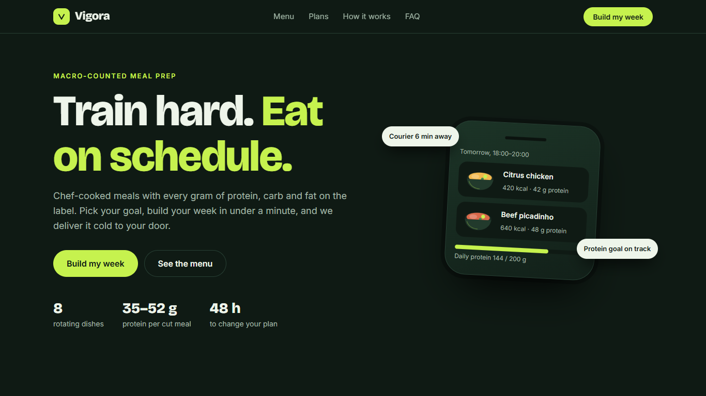
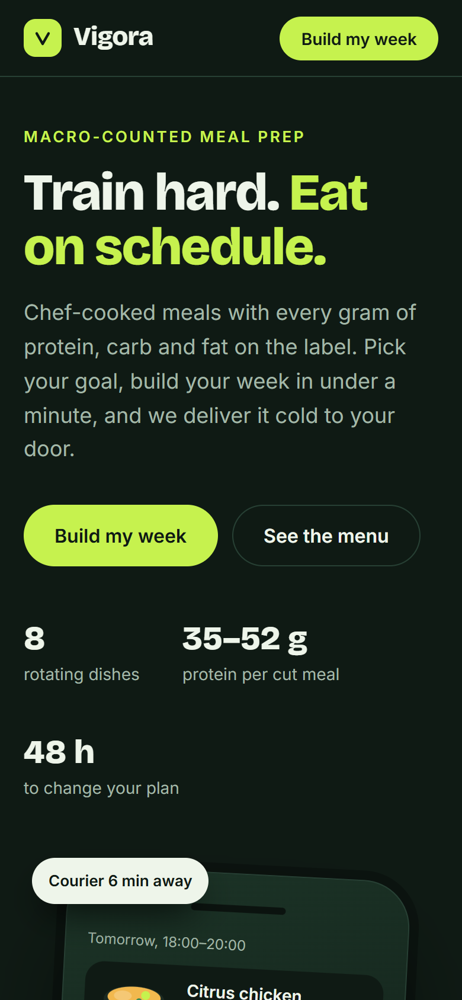

# Vigora — fitness meal-prep delivery (landing page demo)

A responsive landing page for **Vigora**, a fictional macro-counted meal delivery app. Built as a portfolio piece.

**Live demo:** https://alissonlittig.github.io/vigora-marmitas/




## Features
- Menu with goal filters (cutting / maintain / bulking) and per-dish macros
- Live weekly plan builder: pick dishes and a plan size, get price, savings and average macros
- Mobile-first, no horizontal scroll at 390 px, keyboard accessible, reduced-motion aware
- Lighthouse (local): Performance 100 · Accessibility 100 · Best Practices 100 · SEO 91

## Stack
Vite + React 18, plain CSS, Vitest. Pricing logic lives in `src/calc.js` and is unit tested.

## Run
```bash
npm install
npm run dev      # local dev
npm test         # unit tests
npm run build    # production build in dist/
```
CI (`.github/workflows/pages.yml`) runs tests and build on every push and deploys `main` to GitHub Pages.

## Disclaimer
Vigora is a fictional brand. Dishes, prices, reviews and people are invented; no orders are processed and no data is collected.
